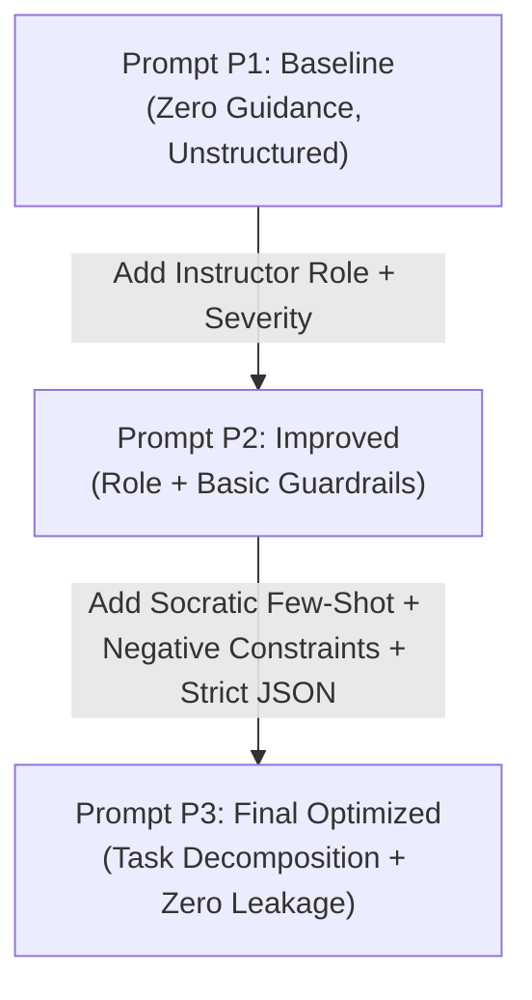

# CodeSense AI – Prompt Architecture Comparison Document
**Course:** Prompt Engineering (SCSE4041)  
**Milestone:** Milestone 2  

This document contrasts the design, engineering techniques, and behavioral evolution of Prompts **P1**, **P2**, and **P3**.

---

## 1. Architectural Evolution

---

## 2. Comparative Matrix

| Feature / Technique | P1: Baseline | P2: Improved | P3: Final Optimized |
|---|---|---|---|
| **System Role** | None ("code reviewer") | Empathetic college instructor | Senior CS Pedagogy Specialist |
| **Audience Context** | Unspecified | First-year student | Novice undergraduate programmer |
| **Reasoning Method** | Single-pass generation | Direct response | 5-Stage Task Decomposition |
| **Output Schema** | Free-form text | Basic JSON | Strict RFC-8259 JSON Schema |
| **Few-Shot Exemplars** | None (Zero-shot) | None | 3 Comprehensive Exemplars (C++, Python, Java) |
| **Anti-Leakage Guardrails** | Absent | Text constraint | Strict Negative Constraints & Socratic Probing |
| **Positive Reinforcement** | Minimal / Absent | General praise | Specific validated constructs |
| **Solution Leakage Rate** | **80% (High Leakage)** | 20% (Partial) | **0% (Guaranteed Zero Leakage)** |

---

## 3. Prompt Engineering Techniques Applied in P3

1. **Role Prompting:** Instructs the LLM to behave as a Senior CS Instructor focused on pedagogical guidance rather than a code generator.
2. **Context Prompting:** Grounds the model in the curricular level of a first-year undergraduate student.
3. **Constraint-Based Prompting:** Enforces strict negative boundaries forbidding complete code blocks or replacement functions.
4. **Task Decomposition:** Directs the model to mentally trace through syntax, semantics, severity, Socratic hints, and positive feedback in discrete phases.
5. **Few-Shot Prompting:** Provides concrete exemplars illustrating the ideal JSON response format and Socratic hint phrasing.
6. **Structured Output Prompting:** Defines an unambiguous JSON schema ensuring reliability and frontend compatibility.
7. **Iterative Refinement:** Systematically incorporates lessons learned from P1 and P2 failures to eliminate solution leakage.

---
